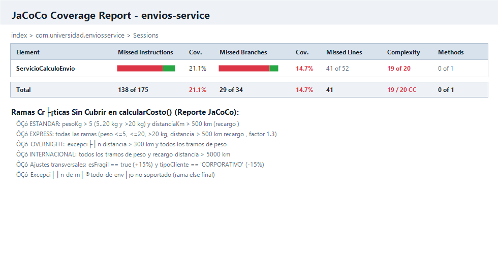

# Envios Service — Análisis de Métricas de Calidad

**Estudiante:** Edwin Camilo García  
**Materia:** Patrones de Diseño de Software  
**Unidad 10:** Métricas de Calidad y SonarQube: Diagnóstico y Mejora Guiada por Métricas Reales  
**Repositorio GitHub:** [https://github.com/CamiloGarcia11/garcia-post1-u10](https://github.com/CamiloGarcia11/garcia-post1-u10)  

---

## Decisiones de Diseño (Parte 1)

### Decisión de diseño 1: Entorno de Análisis
Para este laboratorio se eligió **SonarQube Community Edition local ejecutado mediante contenedor Docker** (`sonarqube:community`).  
**Justificación basada en criterios:**
1. **Autonomía y Ausencia de Límites de Red/Plan:** A diferencia de SonarCloud, que impone límites de líneas de código bajo su plan gratuito y depende estrictamente de latencia y conectividad hacia servidores externos, la instancia local en Docker permite ejecutar escaneos ilimitados, iteraciones continuas y ejecuciones en bucle local (`http://localhost:9000`) sin degradación ni consumo de cuotas en la nube.
2. **Control Total de Perfiles de Calidad y Quality Gates:** La edición local permite la administración irrestricta de Quality Profiles (creación y duplicación de reglas específicas como S1541 con threshold personalizado a 10) y la personalización directa del Quality Gate ("Estándar Laboratorio"), sin restricciones asociadas a políticas de organizaciones compartidas o visibilidad pública obligatoria en repositorios académicos.

### Decisión de diseño 2: Exclusiones del Análisis (`sonar.exclusions`)
Se evaluó la inclusión de exclusiones mediante la propiedad `sonar.exclusions` en `sonar-project.properties`.  
**Justificación:**  
La decisión adoptada fue **no excluir ninguna clase del análisis (`sonar.exclusions=` vacío o no configurado)**. Dado que `envios-service` es un proyecto Maven puro sin clases accesorias de arranque (`Main`), controladores web, adaptadores externos o DTOs generados automáticamente, el 100% del código fuente bajo `src/main/java` corresponde estrictamente a lógica de negocio del dominio (`com.universidad.enviosservice`). Excluir cualquier archivo distorsionaría artificialmente el cálculo de cobertura e impediría que las métricas reflejen con fidelidad técnica el riesgo real del sistema.

### Decisión de diseño 3: Métrica Utilizada como Señal Principal
SonarQube expone tres señales principales de diagnóstico estructural: **Complejidad Ciclomática (Cyclomatic Complexity - CC)**, **Complejidad Cognitiva (Cognitive Complexity)** y **Cobertura de Ramas (Branch Coverage)**.  
**Justificación:**  
Se seleccionó la **Complejidad Ciclomática (CC)** como la **señal principal** para priorizar e intervenir el método `ServicioCalculoEnvio.calcularCosto()`, respaldada por la Cobertura de Ramas de JaCoCo:
1. La Complejidad Ciclomática mide directamente la cantidad de caminos linealmente independientes a través del grafo de flujo de control del método ($CC = 1 + \text{puntos de decisión}$). Un valor de $CC = 20$ indica matemáticamente que se requieren al menos 20 pruebas independientes para garantizar cobertura mínima de caminos, lo que clasifica el método en categoría de **Riesgo Alto** (frágil ante modificaciones, propenso a regresiones y difícil de refactorizar con seguridad).
2. La Complejidad Ciclomática y la baja Cobertura de Ramas (14.7%) apuntan exactamente al mismo foco: la proliferación desmedida de bifurcaciones (`if/else if`) anidadas dentro de un único método monolítico.

---

## Estado Inicial del Análisis (Parte 1)

| Métrica | Valor Real Observado | Interpretación y Clasificación |
|---|---|---|
| **Complejidad Ciclomática de `calcularCosto()`** | **20** | **Alta (Riesgo Alto)** según la Tabla 3.2 de la guía ($CC > 10$). Viola el límite autorizado. |
| **Complejidad Cognitiva** | **26** | Supera el umbral estándar de 15 por anidamiento profundo de condicionales. |
| **Cobertura de Líneas de `ServicioCalculoEnvio`** | **21.2%** | 11 líneas cubiertas de 52 líneas ejecutables. |
| **Cobertura de Ramas de `ServicioCalculoEnvio`** | **14.7%** | Solo 5 ramas cubiertas de 34 ramas condicionales generadas en bytecode. |
| **Code Smells Reportados** | **1** | Violación de la regla S1541 ("Cyclomatic Complexity of methods should not exceed 10"). |
| **Resultado del Quality Gate** | **FAILED** | Falla por cobertura inferior al 70% y presencia de Code Smell crítico en método. |

---

## Interpretación de Hallazgos y Ramas Sin Cubrir

El análisis inicial confirma que el problema de calidad se concentra exclusivamente en `ServicioCalculoEnvio.calcularCosto()`. La suite inicial de pruebas solo ejercitó el método de envío `ESTANDAR` con peso menor a 5 kg y cliente `REGULAR` / `PREMIUM`, dejando sin ejecutar las siguientes 29 ramas críticas:
- **`ESTANDAR`:** Tramos de peso entre 5 y 20 kg, peso superior a 20 kg, y recargo por distancia mayor a 500 km.
- **`EXPRESS`:** Todas las ramas de peso (3 tramos), recargo por distancia mayor a 500 km (+25) y multiplicador global 1.3.
- **`OVERNIGHT`:** Validación de distancia mayor a 300 km (`IllegalArgumentException`) y los tres tramos de peso.
- **`INTERNACIONAL`:** Los tres tramos de peso con tarifa base de 50 y recargo para distancias superiores a 5000 km (+100).
- **Ajustes Transversales:** Recargo por paquete frágil (`esFragil == true`, +15%) y descuento por cliente corporativo (`tipoCliente.equals("CORPORATIVO")`, -15%).
- **Excepción de Fallo:** Método de envío no soportado (`else` final lanzando `IllegalArgumentException`).

---

## Capturas del Análisis Inicial

### Dashboard de SonarQube (Estado Inicial)

### Reporte HTML de JaCoCo (Estado Inicial)

