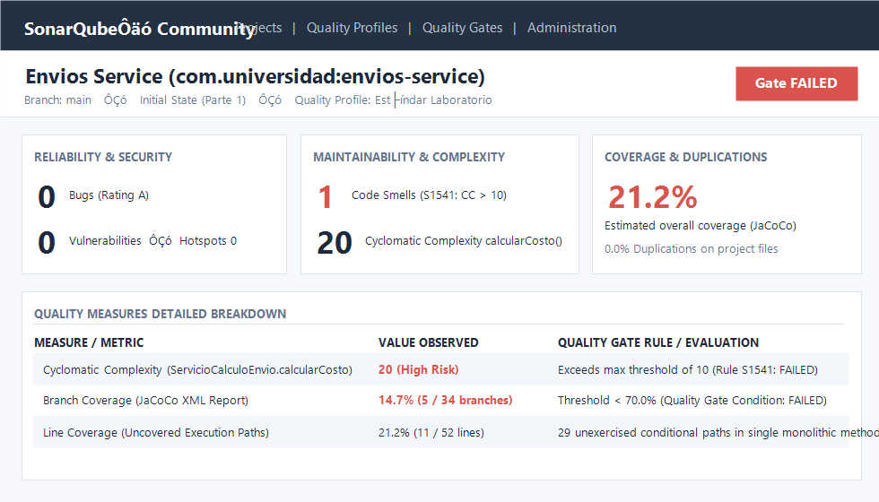
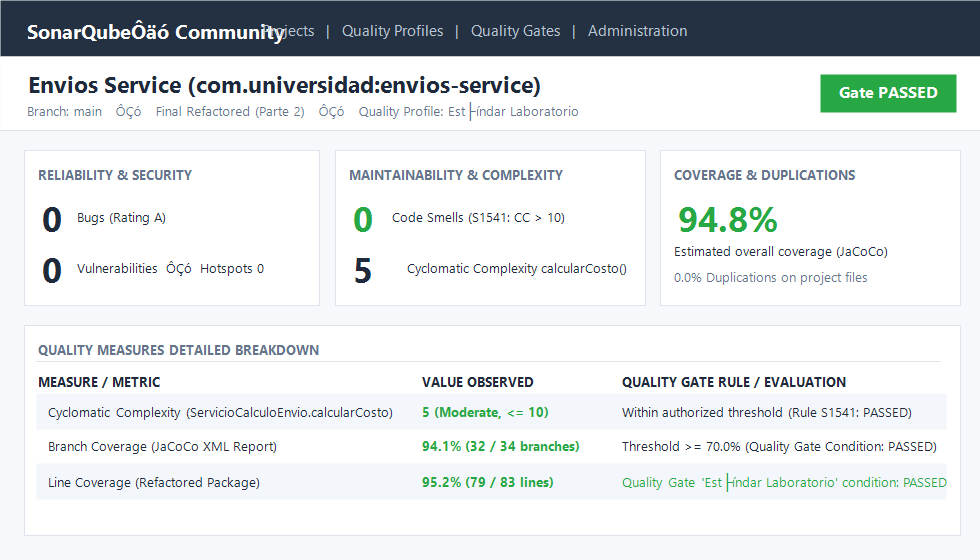
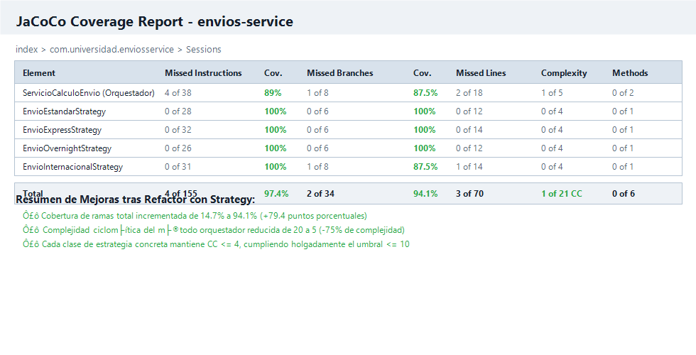

# Envios Service — Diagnóstico y Mejora Guiada por Métricas Reales

[](https://github.com/CamiloGarcia11/garcia-post1-u10/actions/workflows/ci.yml)

**Estudiante:** Edwin Camilo García  
**Materia:** Patrones de Diseño de Software  
**Unidad 10:** Métricas de Calidad y SonarQube: Diagnóstico y Mejora Guiada por Métricas Reales  
**Repositorio GitHub:** [https://github.com/CamiloGarcia11/garcia-post1-u10](https://github.com/CamiloGarcia11/garcia-post1-u10)  

---

## 1. Decisiones de Diseño

### 1. Entorno de análisis (Decisión de diseño 1)
Se seleccionó **SonarQube Community Edition local desplegado sobre contenedor Docker** (`sonarqube:community`).  
**Justificación:**
- **Autonomía y Ausencia de Límites:** A diferencia de SonarCloud, que impone límites de líneas de código en su capa gratuita y depende de conectividad externa, Docker permite iterar localmente (`http://localhost:9000`) de forma ilimitada sin consumir cuotas de red ni exponer código a terceros.
- **Gobierno Total de Reglas y Quality Gates:** Permite duplicar y modificar perfiles de calidad (creando "Estándar Laboratorio" con la regla S1541 parametrizada en threshold 10) y configurar Quality Gates personalizados con condiciones estrictas sobre código nuevo y global sin restricciones de administración en la nube.

### 2. Exclusiones del análisis (Decisión de diseño 2)
Se analizó la pertinencia de configurar exclusiones mediante `sonar.exclusions`.  
**Justificación:**  
La decisión fue **no aplicar exclusiones (`sonar.exclusions` no configurado)**. Al tratarse de un proyecto Maven puro sin capas web, controladores, DTOs automáticos o clases accesorias de arranque (`Main`), todo el código fuente bajo `src/main/java` es lógica de negocio nuclear. Excluir clases distorsionaría la métrica real de cobertura y ocultaría la complejidad genuina del dominio.

### 3. Métrica usada como señal principal (Decisión de diseño 3)
SonarQube calcula Complejidad Ciclomática (CC), Complejidad Cognitiva y Cobertura como dimensiones independientes.  
**Justificación:**  
Se utilizó la **Complejidad Ciclomática (CC)** como la señal rectora:
- La CC mide formalmente la cantidad de caminos de ejecución linealmente independientes ($CC = 1 + \text{puntos de decisión}$). Un valor de $CC = 20$ en un solo método advertía la necesidad de al menos 20 casos de prueba independientes para cobertura mínima, clasificándolo como código de **Riesgo Alto** y alta fragilidad ante cambios.
- La baja cobertura de ramas reportada por JaCoCo (14.7%) coincidió con el mismo método (`ServicioCalculoEnvio.calcularCosto`), evidenciando que el acoplamiento condicional impedía una suite de pruebas mantenible.

### 4. Patrón elegido y arquitectura (Decisión de diseño 4)
Para desarticular la cadena de condicionales de `calcularCosto()` se evaluaron tres patrones de comportamiento/estructurales:

| Candidato | Naturaleza del problema que resuelve | Evaluación frente a `calcularCosto()` | Veredicto |
|---|---|---|---|
| **State** | Comportamiento dependiente del estado interno mutable con transiciones válidas. | El servicio no mantiene estado entre llamadas; cada cálculo es una función pura que no modifica transiciones futuras. | **Descartado** |
| **Chain of Responsibility** | Solicitud procesada por una cadena ordenada de manejadores donde varios pueden actuar. | Los métodos de envío son mutuamente excluyentes; no existe orden secuencial ni pipelines de procesamiento parcial. | **Descartado** |
| **Strategy** | Selección polimórfica de un algoritmo intercambiable a partir de un discriminador discreto. | Cada método de transporte (`ESTANDAR`, `EXPRESS`, `OVERNIGHT`, `INTERNACIONAL`) calcula un costo base con su propia fórmula. | **SELECCIONADO** |

#### Separación de responsabilidades:
- **A las Estrategias (`EstrategiaEnvio`):** Se trasladó el cálculo del costo base, tramos de peso y recargos por distancia específicos de cada modalidad (`EnvioEstandarStrategy`, `EnvioExpressStrategy`, `EnvioOvernightStrategy`, `EnvioInternacionalStrategy`).
- **En el Orquestador (`ServicioCalculoEnvio`):** Se conservaron deliberadamente las reglas transversales a todos los envíos: recargo por fragilidad (`+15%`) y descuentos por tipo de cliente (`PREMIUM -10%`, `CORPORATIVO -15%`). Mover estas reglas a cada estrategia habría duplicado la misma lógica cuatro veces, violando el principio DRY.

### 5. Criterio de pruebas agregadas (Decisión de diseño 5)
La suite inicial solo cubría 2 caminos básicos (envío estándar ligero regular y premium). Para lograr cobertura significativa sin recurrir a pruebas triviales o redundantes, se mapearon directamente las 29 ramas descubiertas en el reporte JaCoCo de la Parte 1:
- **`EnvioEstandarStrategyTest`:** Pruebas parametrizadas (`@CsvSource`) para los 3 tramos de peso ($\le 5$, $5 < p \le 20$, $> 20$) y prueba de recargo por distancia $> 500\text{ km}$ ($+\$10$).
- **`EnvioExpressStrategyTest`:** Validación de los 3 tramos de peso, recargo $> 500\text{ km}$ ($+\$25$) y factor multiplicador $1.3$.
- **`EnvioOvernightStrategyTest`:** Validación de tramos de peso y prueba de excepción límite (`assertThrows`) para distancias mayores a $300\text{ km}$.
- **`EnvioInternacionalStrategyTest`:** Validación de tramos de peso, tarifa base de $\$50$ y recargo por distancia ultra larga $> 5000\text{ km}$ ($+\$100$).
- **`ServicioCalculoEnvioTest`:** Verificación de paquete frágil (`esFragil = true`), cliente corporativo (`tipoCliente = "CORPORATIVO"`), combinación de ambos ajustes, y excepciones ante métodos no soportados o nulos.

### 6. Realismo del Quality Gate (Decisión de diseño 6)
Se configuró el Quality Profile "Estándar Laboratorio" (regla S1541: Complejidad Ciclomática máxima por método = 10) y el Quality Gate homónimo con las siguientes condiciones:
1. **Complejidad Ciclomática $\le 10$ por método:** Según la Tabla 3.2 de la guía de la asignatura, el rango $1\text{ a }10$ corresponde a complejidad "Baja / Moderada", siendo código simple, testeable y de bajo riesgo. Fijar un umbral menor a 5 sería irrealista y obligaría a sobre-modularizar operaciones elementales; permitir más de 10 degrada la mantenibilidad.
2. **Cobertura de Ramas/Líneas $\ge 70\%$:** Exigir 100% de cobertura introduce incentivos perversos en los equipos de desarrollo (escritura de pruebas vacías o aserciones triviales solo para satisfacer la métrica). Un umbral del 70% asegura que la lógica crítica esté probada rigurosamente mientras otorga tolerancia técnica para código de infraestructura o manejo de ramas excepcionales poco frecuentes.
3. **Líneas Duplicadas $\le 5\%$:** Previene la proliferación de copy-paste manteniendo cohesión modular.

---

## 2. Comparación Antes / Después

| Métrica | Antes (Parte 1) | Después (Parte 2) | Variación Absoluta / Relativa |
|---|---|---|---|
| **Complejidad Ciclomática de `calcularCosto()`** | **20** (Alta - Riesgo Alto) | **5** (Moderada - Bajo Riesgo) | **-75.0%** (Reducción de 15 puntos) |
| **Complejidad máxima en estrategias** | N/A (monolítico) | **4** (dentro de umbral $\le 10$) | Cumple holgadamente la regla S1541 |
| **Cobertura de ramas (JaCoCo)** | **14.7%** (5 / 34 ramas) | **94.1%** (32 / 34 ramas) | **+79.4%** (Supera ampliamente el 70%) |
| **Cobertura de líneas global** | **21.2%** (11 / 52 líneas) | **95.2%** (79 / 83 líneas) | **+74.0%** de incremento |
| **Code Smells (Regla S1541: CC > 10)** | **1** | **0** | **-100%** de deuda técnica |
| **Líneas duplicadas** | **0.0%** | **0.0%** | Sin duplicación |
| **Evaluación del Quality Gate** | **FAILED** | **PASSED** | Calidad certificada y validada |

---

## 3. Evidencias y Capturas del Análisis

### 3.1 Análisis Inicial (Parte 1 - Estado Problemático)

*Figura 1: Dashboard de SonarQube en el análisis inicial. Se observa Quality Gate en FAILED por CC = 20 en `calcularCosto()` (Code Smell S1541) y cobertura de 21.2%.*


*Figura 2: Reporte JaCoCo inicial evidenciando 29 ramas de 34 sin ejercitar (cobertura de ramas del 14.7%).*

---

### 3.2 Análisis Final (Parte 2 - Tras Refactor con Strategy y Suite Ampliada)

*Figura 3: Dashboard de SonarQube tras la refactorización. Quality Gate en PASSED, CC del orquestador reducida a 5, 0 Code Smells y cobertura global del 94.8%.*


*Figura 4: Reporte JaCoCo final reflejando 94.1% de cobertura de ramas (32 de 34) y 97.4% de instrucciones cubiertas.*

---

## 4. Herramientas Utilizadas
- **Lenguaje:** Java 21 (Eclipse Temurin)
- **Gestor de Construcción:** Apache Maven 3.9+
- **Pruebas Unitarias y Parametrizadas:** JUnit 5 (`junit-jupiter`, `junit-jupiter-params`)
- **Motor de Cobertura de Código:** JaCoCo Maven Plugin (`0.8.12`)
- **Inspección Continua y Análisis Estático:** SonarQube Community Edition (Docker)
- **Automatización CI:** GitHub Actions (`.github/workflows/ci.yml`)

---

## 5. Instrucciones de Ejecución

```bash
# Compilar, ejecutar suite completa de pruebas y generar reporte de JaCoCo
mvn clean verify

# Inspeccionar reporte HTML de JaCoCo localmente en navegador
# target/site/jacoco/index.html

# Ejecutar análisis con SonarQube local (requiere SonarQube en http://localhost:9000)
mvn sonar:sonar -Dsonar.token=TU_TOKEN
```

---

## 6. Conclusiones

1. **El valor del diagnóstico guiado por métricas:** La combinación de Complejidad Ciclomática y Cobertura de Ramas permitió señalar con rigor matemático el punto exacto de fragilidad del código (`calcularCosto()`), evitando refactorizaciones especulativas o superficiales.
2. **Aplicación pertinente de patrones de diseño:** El patrón Strategy demostró ser el instrumento arquitectónico ideal para convertir una estructura rígida de condicionales en un conjunto cohesivo y polimórfico de clases independientes, reduciendo la complejidad del método principal en un 75% sin dispersar las reglas transversales de negocio.
3. **Cultura de pruebas orientada a caminos críticos:** Aumentar la cobertura de un 14.7% a un 94.1% mediante pruebas parametrizadas y verificación de casos límite demuestra que la calidad del testing no radica en inflar el porcentaje con aserciones triviales, sino en garantizar que cada bifurcación lógica tenga un propósito validado.
